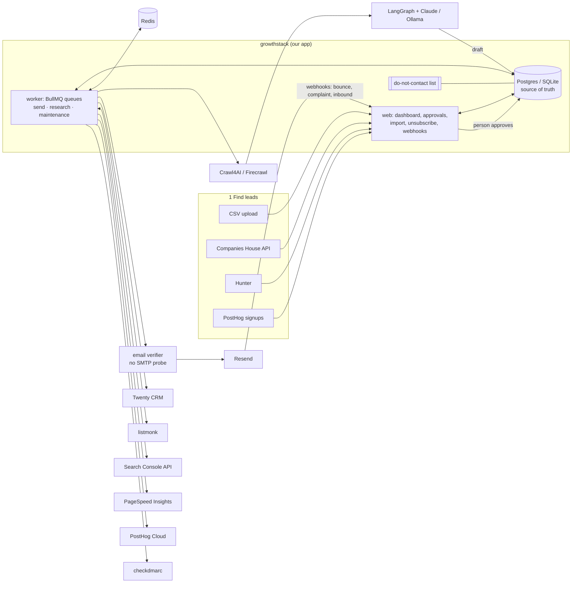
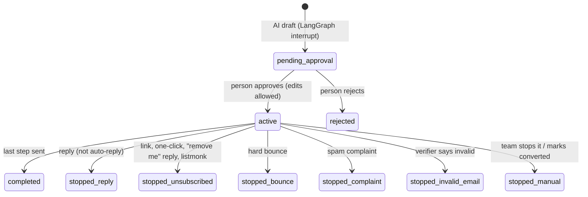

# Architecture

## Overview

Two processes share one database:

- **web** (`growthstack web`, FastAPI): the team UI plus the public unsubscribe page and
  the Resend webhook. It only touches the database, never Redis.
- **worker** (`growthstack worker`): three BullMQ queues and the job schedulers.

### Why the database is the source of truth

Web requests change rows; a **dispatcher** (every 15 s) moves due work into BullMQ:
`SCHEDULED` messages become delayed jobs with id `msg-<id>`, and leads marked for research
become `research` jobs. Consequences:

- No job can be lost between a database commit and a Redis enqueue.
- Cancelling is a database update. The send job re-checks everything before sending, and
  the dispatcher also removes cancelled jobs from Redis.
- If Redis is wiped, `SCHEDULED` messages whose job is gone are re-enqueued (after 30 min).

## Outreach lifecycle

Messages: step 1 is `SCHEDULED` at approval. When step N is sent, step N+1 becomes
`SCHEDULED` at `sent_at + delay_hours`. Any stop moves every unsent message to `CANCELLED`.

### What happens right before every send (`outreach/delivery.py`)

1. Message still `SCHEDULED`, enrollment still `ACTIVE`, lead not replied/converted.
2. Address not on the do-not-contact list (email or whole domain).
3. Address verified within 30 days (syntax, MX, disposable, role; **never an SMTP probe**).
4. Mailbox limits (`outreach/policy.py`): rolling 24 h cap, minimum gap between sends,
   sending window (UTC hours, weekdays). If held back, the job is moved back to BullMQ's
   delayed set (`job.moveToDelayed` + `DelayedError`) and `deferred_until` is recorded.
   The sequence's own due time (`scheduled_for`) is never moved, so limit or window
   changes apply on the next attempt.
5. A Redis lock per mailbox serialises steps 4-5 across worker processes.
6. Send through Resend with idempotency key `outbound-<message id>`, so a retry after a
   crash can't double-send. Retryable errors: 5 attempts with exponential backoff.
   4xx rejections fail the message immediately.

BullMQ's Python worker has no per-group rate limiter (that is a BullMQ Pro feature), which
is why steps 4-5 exist.

### Every email carries

- `List-Unsubscribe: <https://…/u/TOKEN>` and `List-Unsubscribe-Post: List-Unsubscribe=One-Click`
  (RFC 8058; Gmail/Yahoo bulk-sender requirement). A POST to `/u/TOKEN` unsubscribes at once.
  A GET only shows a confirm button, because link scanners prefetch GETs.
- A visible unsubscribe link and the company's postal address.
- On the first email only, where we got their details (GDPR Art. 14), from `source_detail`.
- Follow-ups thread under the first email (`In-Reply-To`/`References` = our Message-ID).

### Reply detection (`outreach/replies.py`)

- IMAP polling per mailbox (`BODY.PEEK`, read-only, tracks the last UID), and/or Resend's
  `email.received` webhook.
- Matching: `In-Reply-To`/`References` against our Message-IDs, else sender address = lead email.
- Auto-replies (`Auto-Submitted`, `X-Autoreply`, `Precedence`, "Out of office" subjects) are
  recorded but don't stop anything.
- "Remove me / unsubscribe / stop emailing" in the new part of a reply (quoted text is
  ignored) adds the address to the do-not-contact list.

## AI pipeline (`ai/pipeline.py`)

LangGraph graph with a SQLite checkpointer:
`research → analyse → score → [gate] → draft → review → finalize`.

- **research**: crawler reads the site (`robots.txt` respected, Crawl4AI stealth/magic/
  simulate_user explicitly off, SSRF guard on every URL and redirect). The email is verified.
- **analyse**: LLM returns schema-constrained JSON: summary, fit 0-100, reasons, one hook.
- **score**: `scoring.py` (below). The gate stops leads with no email, on the do-not-contact
  list, with an invalid address, or below `MIN_SCORE_TO_DRAFT`.
- **draft**: LLM writes a plain-text email; the enrollment and all step messages are created
  as drafts.
- **review**: `interrupt()`, so the run pauses until a person approves, edits or rejects in
  `/approvals`, which resumes it with `Command(resume=decision)`. If the checkpoint is
  missing, the decision is applied directly so reviewers are never stuck.

Website text is untrusted input. It is fenced in tags with an instruction to treat it as
data, outputs are JSON-schema constrained, and a person reads every email before it can be
sent.

LLM providers: `anthropic` (Claude via the official SDK, structured outputs, server-side
refusal fallback enabled), `ollama` (local, free), `fake` (offline placeholder for dev and
tests; production refuses to start with it).

## Lead scoring (`scoring.py`)

A transparent weighted sum, 0-100, with the breakdown stored and shown per lead:

| Part | Max | Source |
|---|---|---|
| Job title matches target roles | 20 | CRM fields |
| Country in targets | 7.5 | CRM fields (half if no targets set) |
| SIC code in target industries | 7.5 | CRM fields / Companies House (half if no targets set) |
| AI fit judgement × 0.4 | 40 | Website research |
| PostHog events in 30 days | 25 | PostHog activity (0 / 10 / 18 / 25) |
| Email check | −10 risky, score 0 if invalid | verifier |

## Design decisions

| Decision | Alternatives considered | Why |
|---|---|---|
| Python + FastAPI | Node/TypeScript (BullMQ's home) | LangGraph, Crawl4AI, checkdmarc are Python; BullMQ has an official Python port on the same Redis protocol. Node was not available to verify a TS build. |
| DB-first dispatcher → BullMQ | Enqueue directly from web requests | No lost jobs between commit and enqueue; web stays Redis-free; cancellation is a row update. |
| Own per-mailbox limiter | BullMQ group rate limits | Group limits are BullMQ Pro only; Python worker has no `limiter`. |
| Python email verifier replicating AfterShip's non-SMTP checks | AfterShip Go library as a sidecar | Same checks and data sources, no Go toolchain/service to run; SMTP probing stays off (the doc's reason for choosing it over Reacher). Swap-in point: `verify/email_verifier.py`. |
| Plain-text outreach emails | react-email HTML templates | One-to-one cold email reads (and delivers) best as plain text with no tracking pixel; react-email needs Node. react-email remains the choice for listmonk newsletters. |
| Server-rendered HTML, SVG charts | SPA + chart library | No build step, no CDN, strict CSP (`default-src 'self'`). |
| Scrypt (stdlib) password hashes | bcrypt/argon2 packages | No extra dependency; memory-hard. |
| SQLite in dev/tests, Postgres in production | Postgres everywhere | Zero-setup dev; schema and queries are portable (Alembic with batch mode). |
